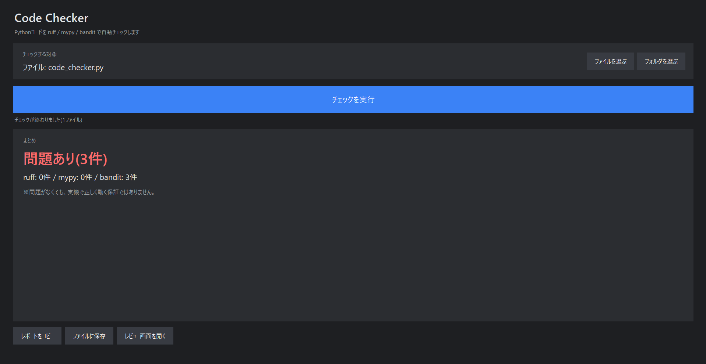
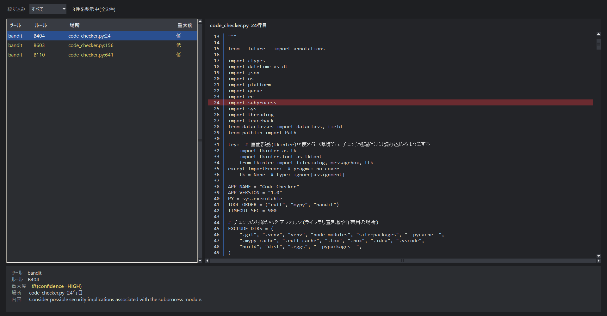

# Code Checker

Pythonコードを **ruff・mypy・bandit** の3つのツールでまとめてチェックし、結果をAI(ChatGPT・Claude など)に貼り付けて相談しやすい「レポート」にまとめる、Windows用のデスクトップアプリです。

- ボタン1つで3つのツールを実行できます。コマンドの入力は不要です。
- 設定ファイルを読み込まず、ルールを固定しているため、AIが書いたコードも自分で直したコードも **同じ基準** で調べられます。
- チェック対象のファイルは **読み取るだけ** で、書き換えません。

> このアプリは Claude(Anthropic社のAI)が作成しました。詳しくは「[このアプリについて](#このアプリについて)」を参照してください。

## 画面イメージ

通常のチェック画面です。

レビュー画面です。指摘された行が、コードの中で赤く光ります。

> **画面例について:** この画像は、Code Checker 自身のコード(`code_checker.py`)をチェックしたものです。bandit の指摘が3件出ていますが、どれも「確認は必要だが、このアプリでは問題のない書き方」と確認済みです。
>
> | ルール | 場所 | 指摘の内容 | 問題がない理由 |
> |---|---|---|---|
> | B404 | `import subprocess` | 他のプログラムを動かす部品を使っています | ruff・mypy・bandit を動かすために必要です |
> | B603 | `subprocess.run(...)` | 他のプログラムを動かしています | 実行するのは、このアプリが組み立てた固定のコマンドだけです。入力された文字を、そのままコマンドにはしていません |
> | B110 | `try` / `except` / `pass` | エラーが出ても何もしない書き方です | 画面の表示を整えるだけの処理で、失敗しても動作に影響しません |
>
> bandit は「注意が必要な書き方」を機械的に見つけるツールなので、指摘が出ても修正が必要とは限りません。指摘を見て、本当に問題があるかを判断してください。

## 目次

- [画面イメージ](#画面イメージ)
- [機能](#機能)
- [ご使用前の注意](#ご使用前の注意)
- [動作環境](#動作環境)
- [インストール(初回のみ)](#インストール初回のみ)
- [使い方](#使い方)
- [画面の見方](#画面の見方)
- [チェックの設定](#チェックの設定)
- [ツールを更新したいとき](#ツールを更新したいとき)
- [うまく動かないとき](#うまく動かないとき)
- [ファイル構成](#ファイル構成)
- [使用しているツールとライセンス](#使用しているツールとライセンス)
- [このアプリについて](#このアプリについて)
- [免責](#免責)
- [ライセンス](#ライセンス)

---

## 機能

### 3つのチェックツールの一括実行

| ツール | 内容 | 検出するもの |
|---|---|---|
| [ruff](https://github.com/astral-sh/ruff)(ラフ) | 書き方のチェック | 書き方の誤り、使っていない部品、存在しない名前の呼び出しなど |
| [mypy](https://github.com/python/mypy)(マイパイ) | データの種類のチェック | データの種類の食い違い |
| [bandit](https://github.com/PyCQA/bandit)(バンディット) | 安全面のチェック | セキュリティ上の弱点になりうる書き方 |

### レポートのコピー・保存

「レポートをコピー」ボタンで、チェック結果をAIが読みやすい形でコピーできます。AIのチャット欄に貼り付けて、修正や指摘内容の確認を依頼できます。「ファイルに保存」ボタンで、テキストファイルとして保存することもできます。

レポートには、次の内容が含まれます。

- 指摘箇所の一覧(ファイル名・行番号・内容。1件につき1行)
- 各ツールが出力した結果の原文(加工なし)
- ツールのバージョン、Pythonのバージョン、チェックした日時、実行したコマンド

### 結果のまとめ表示とレビュー画面

画面の最上部に、結果が色付きで表示されます。「レビュー画面」では、指摘された箇所をコードと並べて確認できます。詳しくは「[画面の見方](#画面の見方)」を参照してください。

---

## ご使用前の注意

- 「問題なし」と表示されても、**コードが正しく動作することの保証ではありません。** 本アプリが行うのは、書き方・データの種類・安全面の機械的なチェックです。実際に動かして確認する作業(実行テスト)の代わりにはなりません。
- チェックするのは、拡張子が `.py` のファイルだけです。3つのツールで調べる範囲をそろえるため、`.pyi`・`.pyw`・`.ipynb` は対象外です。
- 次のフォルダは、チェック対象から除外されます: `.venv`、`venv`、`node_modules`、`build`、`dist`、`site-packages`、`__pycache__`、`.git` など、および名前が `.egg-info` で終わるフォルダ。
- mypy は `--ignore-missing-imports` を付けて実行します(外部ライブラリが見つからない旨の警告を出しません)。本アプリ専用の環境には、チェック対象のコードが使う外部ライブラリが入っていないためです。そのため、外部ライブラリが関係するデータの種類の食い違いは、検出できない場合があります。
- 動作確認を行った環境は **Windows 11 + Python 3.15.0** のみです。

---

## 動作環境

| 項目 | 内容 |
|---|---|
| OS | Windows 11 |
| Python | tkinter(画面表示用の部品)を含むもの。通常のインストールであれば含まれています。 |
| インターネット接続 | 初回のインストール時のみ必要です(ツールのダウンロードに使用します)。 |

python.org の公式インストーラーを使用する場合は、インストール時に「Add python.exe to PATH」にチェックを入れてください。

---

## インストール(初回のみ)

1. このページの緑色の「Code」ボタンをクリックし、「Download ZIP」を選択してダウンロードします。
   - Git に慣れている方は、`git clone` でも取得できます。
2. ダウンロードしたzipファイルを右クリックし、「すべて展開」を選択します。
3. 展開してできたフォルダを、任意の場所に移動します。
   - zipファイルの中から直接ファイルを実行しないでください。
4. フォルダ内の `1_setup.bat` をダブルクリックします。
5. 黒い画面が開き、ツールの導入が始まります。数分かかる場合があります。
6. 「Setup finished.」と表示されたら完了です。何かキーを押して画面を閉じます。

補足:

- 途中で「Building it again without the C++ part」と表示されることがありますが、正常な動作です(bandit用の部品を作り直しています)。
- 途中で `[ERROR]` と表示された場合は、黒い画面の文字をすべてコピーし、AIのチャット欄に貼り付けて相談してください。
- ツールは、フォルダ内に作られる専用の場所(`.venv`)にだけ入ります。お使いのPython本体には影響しません。

---

## 使い方

1. フォルダ内の `2_start.vbs` をダブルクリックします。黒い画面は表示されず、Code Checker の画面だけが開きます。
   - 起動に失敗した場合のみ、エラー文が表示された黒い画面が開きます(「[うまく動かないとき](#うまく動かないとき)」を参照)。
2. 「ファイルを選ぶ」または「フォルダを選ぶ」をクリックし、チェックしたい対象を選択します。
3. 「チェックを実行」をクリックします。しばらく待つと、画面に「まとめ」が表示されます。
4. 「レポートをコピー」をクリックし、AIのチャット欄に貼り付けて相談します。
   - テキストファイルとして残す場合は、「ファイルに保存」をクリックします。
5. 指摘された箇所をコードと並べて確認する場合は、「レビュー画面を開く」をクリックします。

同梱の `使い方.txt` にも、同じ内容の説明があります。

---

## 画面の見方

### まとめ

| 表示 | 色 | 意味 |
|---|---|---|
| 🟢 問題なし | 緑 | 指摘が0件でした。 |
| 🔴 問題あり(○件) | 赤 | 指摘が○件ありました。 |
| 🟠 チェック未完了 | オレンジ | ツールが動作せず、チェックを完了できませんでした。 |

### レビュー画面

| 場所 | 内容 |
|---|---|
| 左側 | 指摘の一覧。上部の「絞り込み」で、ツールごとに表示を切り替えられます。 |
| 右側 | 一覧で選んだ指摘のファイルのコード |
| 下部 | ツール名、ルール名、重大度、場所、内容 |

- 選んだ指摘の行は赤っぽく、同じファイルの他の指摘の行は茶色っぽく光ります。
- 下部の「内容」は、ツールが出力した英語の文章がそのまま表示されます。

---

## チェックの設定

| ツール | 設定 |
|---|---|
| ruff | 設定ファイルを読み込まず、検査するルールを E4、E7、E9、F に固定します。自動修正はしません。 |
| mypy | 設定ファイルを読み込まず、`--ignore-missing-imports` を付けて実行します。 |
| bandit | 設定ファイルを読み込まず、標準設定で実行します。重大度は bandit の HIGH / MEDIUM / LOW をそのまま使用します。 |

ルールを変えたい場合は、`code_checker.py` の冒頭にある `RUFF_RULES` などを編集してください。

---

## ツールを更新したいとき

`1_setup.bat` をもう一度ダブルクリックしてください。3つのツール(ruff・mypy・bandit)が最新の状態になります。

---

## うまく動かないとき

### 起動に失敗した場合

起動に失敗すると、エラー文が表示された黒い画面が開きます。黒い画面の文字をすべてコピーし、AIのチャット欄に貼り付けて相談してください。同じ内容は、フォルダ内の `start_log.txt` にも保存されます。

### 起動しても何も起きない場合

`2_start.bat` をダブルクリックしてください。黒い画面が表示された状態で起動するため、表示される文字から原因を確認できます。

### 画面の見た目がおかしい場合

エラー文に加えて、画面の画像(png など)も一緒にAIへ送って相談してください。

### 不具合の報告について

このページの「Issues」から報告できます。エラー文を貼り付けてください。ただし、エラー文には自分のパソコンのフォルダ名やユーザー名が含まれることがあるため、貼り付ける前に確認してください。

不具合の報告は現在準備中なので準備が終了次第報告が可能となります

---

## ファイル構成

| ファイル | 説明 |
|---|---|
| `code_checker.py` | アプリ本体 |
| `1_setup.bat` | 初回のみ実行するインストール用ファイル(ツールを更新するときにも使用します) |
| `2_start.vbs` | 通常使用する起動用ファイル(黒い画面が表示されません) |
| `2_start.bat` | `2_start.vbs` が内部で使用する起動用ファイル(黒い画面を表示して試したいときにも使用できます) |
| `使い方.txt` | 使い方の説明 |
| `README.md` | このファイル |
| `LICENSE` | ライセンス(MIT) |

次のものは、このページには含まれません。使っているうちに、自分のパソコンの中に自動で作られます。

| 名前 | 説明 |
|---|---|
| `.venv` フォルダ | `1_setup.bat` が作る、本アプリ専用のツール置き場(削除しても、`1_setup.bat` をもう一度実行すれば作り直せます) |
| `start_log.txt` | 起動時のメッセージの記録(起動のたびに作り直されます) |

---

## 使用しているツールとライセンス

ruff・mypy・bandit は、それぞれの開発元が公開している別のソフトウェアです。このページには含まれておらず、`1_setup.bat` が公式の配布元(PyPI)から導入します。各ツールのライセンスは、それぞれの配布元で確認してください。

---

## このアプリについて

本アプリは **Claude(Anthropic社のAI)が作成しました。** 作者の依頼を受け、Claude が設計・実装を行っています。

---

## 免責

本アプリは現状のまま提供されます。本アプリの使用によって生じた損害について、作者は責任を負いません。チェック結果は参考情報であり、コードの正しさや安全性を保証するものではありません。

---

## ライセンス

[MIT License](LICENSE)
